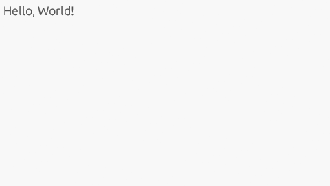
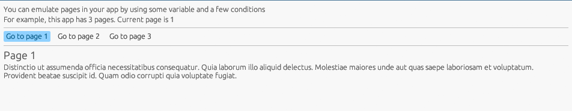
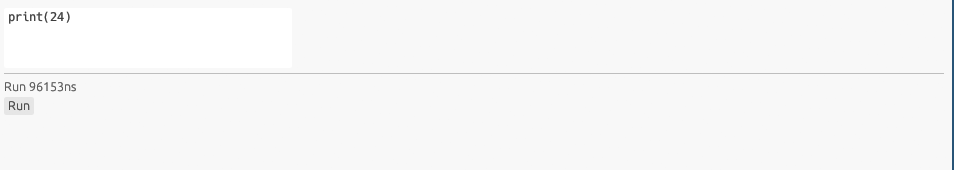
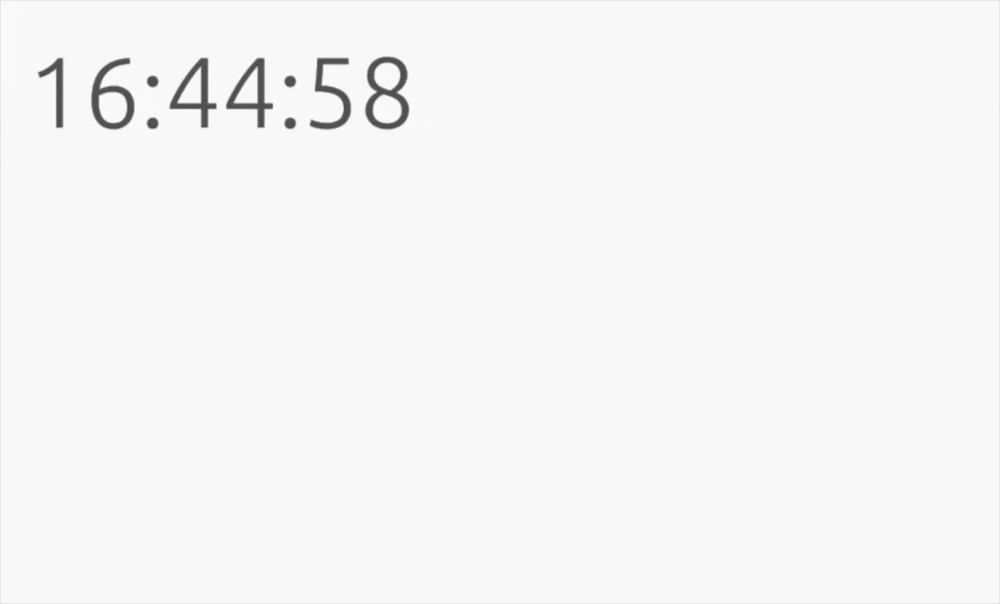
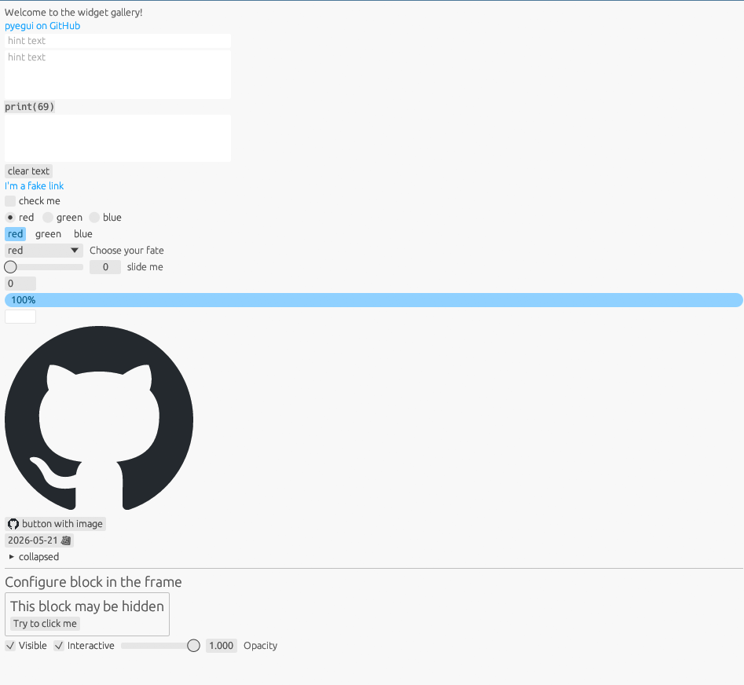

Examples
===========

hello world
-------------

.. literalinclude:: ../examples/hello_world.py
   :language: python
   :linenos:

pages
-------------

.. literalinclude:: ../examples/pages.py
   :language: python
   :linenos:

fileviwer
-------------

.. literalinclude:: ../examples/fileviwer.py
   :language: python
   :linenos:

.. image:: _static/fileviwer.png
   :alt: pages screenshot

python IDE
-------------

.. literalinclude:: ../examples/python-ide.py
   :language: python
   :linenos:

animation
-------------

.. literalinclude:: ../examples/animation.py
   :language: python
   :linenos:

watch
-------------

.. literalinclude:: ../examples/watch.py
   :language: python
   :linenos:

all widgets
-------------

.. literalinclude:: ../examples/widget_gallery.py
   :language: python
   :linenos:

