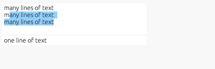
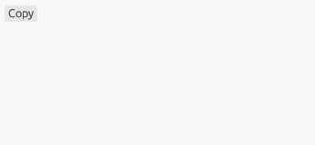
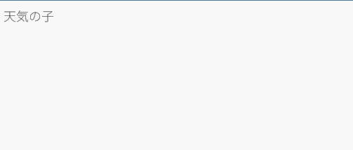
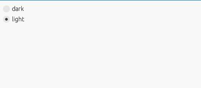
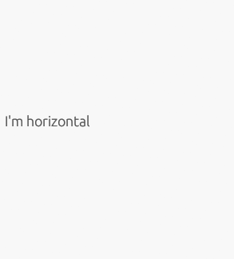

How to
===========

Copy text to clipboard
------------------------

All text elements support copy operation:

.. literalinclude:: ../guides/copytext.py
   :language: python
   :linenos:

However you can copy text programmatically:

.. literalinclude:: ../guides/copytextprog.py
   :language: python
   :linenos:

Open URL in a browser
--------------------------

Links are opened when clicked on. Also you can open them using ``ctx.open_url()``

.. literalinclude:: ../guides/openurl.py
   :language: python
   :linenos:

Display non-latin and non-cyrillic characters
-------------------------------------------------------

Download ``ttf`` font file and distribute it with your app

.. literalinclude:: ../guides/fonts.py
   :language: python
   :linenos:

Set theme
-------------

By default system's theme is used.
Theme is changed using these methods:

.. code-block:: python

  ctx.set_light_theme()
  ctx.set_dark_theme()
  ctx.set_system_theme()

Set cursor icon
-----------------

Set the cursor icon.

.. code-block:: python

  ctx.set_cursor_icon(CursorIcon.Wait)

Example app:

.. literalinclude:: ../guides/themes.py
   :language: python
   :linenos:

Center elements vertically
-----------------------------

.. literalinclude:: ../guides/centerhor.py
   :language: python
   :linenos:

Center elements horizontally 
-----------------------------

.. literalinclude:: ../guides/centerver.py
   :language: python
   :linenos:

.. image:: _static/centerver.png
   :alt: horizontally centered label screenshot

Center elements vertically and horizontally 
----------------------------------------------

You can do that for one element:

.. code:: python

   with Layout(LayoutType.CenteredAndJustified):
      heading("Perfect center")

For more elements, read why you can't:

https://users.rust-lang.org/t/help-with-alignment-in-eframe-egui/133702
